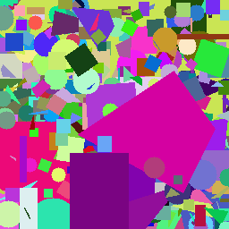
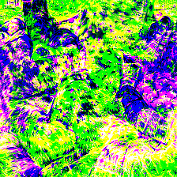
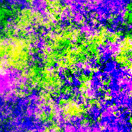
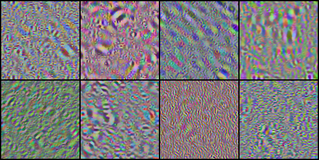
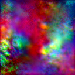
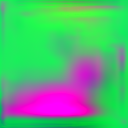
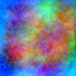
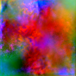

# simple_kd

[](https://pytorch.org/)
[](https://huggingface.co/docs/accelerate/)
[](https://opensource.org/licenses/MIT)
[](https://github.com/astral-sh/ruff)

simple_KD is a library that combines non data free methods implemented by repositories such as mdistiller and the Knowledge Distillation Zoo as well as popular data free distillation methods and implements them with pytorch-style structure and calling. The library also uses the Hugging Face
accelerate library in order to support multiple GPUs.

---

## Table of Contents

- [Overview](#overview)
- [Conveniences](#conveniences)
- [Supported Distillation Methods](#supported-distillation-methods)
  - [Logit-Based Distillation](#logit-based-distillation)
  - [Feature & Attention-Based Distillation](#feature--attention-based-distillation)
  - [Relational Distillation](#relational-distillation)
  - [Dynamic & Skeptical Arbitration](#dynamic--skeptical-arbitration)
  - [Data-Free Knowledge Distillation (DFKD)](#data-free-knowledge-distillation-dfkd)
  - [Synthetic Noise & Inductive Bias Generators](#synthetic-noise--inductive-bias-generators)
- [Installation](#installation)
- [Data & Hook Utilities](#data--hook-utilities)
- [Included Examples](#included-examples)
- [Performance Results (CNNs)](#performance-results-cnns)
- [Performance Results (ViTs)](#performance-results-vits)
- [Performance Results (Cross-arch)](#performance-results-cross-arch)
- [Testing & Quality Verification](#testing--quality-verification)
- [Acknowledgements](#acknowledgements)
- [License](#license)

---

## Overview

**`simple_kd`** is designed to collect all the relevant knowledge distillation methods when implementing, testing, and scaling in a single place, avoiding digging and understanding multiple and usually deprecated repositories. Whether you are performing standard logit matching, intermediate feature alignment, relational metric transfer, or zero-data distillation with adversarial generators, `simple_kd` provides composable, highly tested primitives. Currently the methods are only concerning Classification tasks, with plans in the future to also include segmentation and other kinds of problems.

### Conveniences:
- **Unified APIs**: All loss functions provide both standard PyTorch `nn.Module` classes and zero-overhead functional counterparts (`simple_kd.losses.functional`).
- **Distributed by Default**: Built from the ground up on Hugging Face [Accelerate](https://huggingface.co/docs/accelerate/) — effortlessly runs on CPU, single GPU, Multi-GPU Distributed Data Parallel (DDP), and mixed precision (`fp16`, `bf16`).
- **Data-Free Distillation Ready**: Full end-to-end training loops for **DAFL**, **DFAD**, and **ZSKT**, along with other methods, including unified generator statistics tracking (entropy, confidence, diversity spread) and gradient clipping.
- **Synthetic Noise Datasets**: Generates structured noise datasets (Dead Leaves, Fourier Feature Inversion, Wavelet Steerable Pyramids, Untrained StyleGAN2) allowing networks to learn visual inductive biases without natural data.
- **Simplicity**: Designed from scratch to be easy to pick up and familiar to the pytorch syntax.
- **Zero-Leak Hook Management**: `FeatureSelector` automatically manages PyTorch forward hooks and garbage collection for multi-layer representation distillation.
- **A vast amount of available techniques**: Logit matching (KD, DKD), spatial attention (AT), representation similarity (SP, SSP), geometric relationships (RKD-Distance, RKD-Angle, PKT), and skeptical student gating.
- **Modular Data-Free Engines**: Plug-and-play adversarial and generative distillation algorithms.
- **Telemetry & Artifacts**: Automatic CSV training history logging, metric summaries, and Parquet prediction matrices for evaluation.
- **Plethora of examples**: Multiple of examples covering all the possible usecases, from utilizing the existing pre-defined training pipelines to integrating complex distillation processes in a custom pipeline.

---

## Supported Distillation Methods

### Logit-Based Distillation
| Method | Class | Functional | Key Idea |
| :--- | :--- | :--- | :--- |
| **KD** | `KDLoss` | `kd_loss` | The original implementation, matching the teacher and student probabilities through the KL divergence |
| **DKD** | `DKDLoss` | `dkd_loss` | The incorrect classes carry possible more knowledge than the correct one (dark knowledge) |

### Feature & Attention-Based Distillation
| Method | Class | Functional | Key Idea |
| :--- | :--- | :--- | :--- |
| **AT**     | `ATLoss`     | `at_loss`     | Attention map matching between the teacher and the student models |
| **CC**     | `CCLoss`     | `cc_loss`     | Attempts to improve correlation between the teacher and the student |
| **KD_SVD** | `KD_SVDLoss` | `kd_svd_loss` | Uses SVD on intermediate layers of the student in order to extract information |
| **Sobolev**| `SobolevLoss` | `sobolev_loss`| Encodes additional information by incorporating target derivates along the target values |
| **SP**     | `SPLoss`     | `sp_loss`     | Attempts to match the teacher and student representation space by keeping similar pairwise similarities |
| **SSP**    | `SSPLoss`    | `ssp_loss`    | Based on the [fitnets](https://arxiv.org/pdf/1412.6550) approach. Passes the stages through spatial pooling and then directly matches the teacher and student features | Custom |

### Relational Distillation
| Method | Class | Functional | Key Idea |
| :--- | :--- | :--- | :--- |
| **NST**| `NSTLoss`| `nst_loss`| Student mimics neuron co-activations from the teacher. |
| **RKD-Dist** | `RKDDistLoss` | `rkd_distance_loss` | Attempts to match the representation space of the teacher through the distance of couples |
| **RKD-Angle** | `RKDAngleLoss` | `rkd_angle_loss` | Attempts to match the representation space of the teacher via the angle formed by a triplet of samples |
| **PKT** | `PKTLoss` | `pkt_loss` | Distills through the representation space rather than the final predictions |

### Dynamic & Skeptical Arbitration
| Method | Class | Functional | Key Idea |
| :--- | :--- | :--- | :--- |
| **Skeptical** | `SkepticalLoss` | `skeptical_loss` | Attempts to distill from a nasty teacher by distilling from earlier layers, which remain mostly unaffected |

### Data-Free Knowledge Distillation (DFKD)
| Method | Function | Key Idea |
| :--- | :--- | :--- |
| **DAFL** | `dafl_train` | Multi-objective Generator based method for data free training of the student network|
| **DFAD** | `dfad_train` | Minimize the discrepancy between the teacher and the student. Directly applicable to segmentation tasks |
| **ZSKT** | `zskt_train` | A generator creates examples that the student poorly matches the teacher, and then trains on them |
| **Gaussian distillation** | `gaussian_train`| Utilizes gaussian noise (or even synthetic noise) in order to train through the saved batch statistics |
| **ODSD** | `odsd_train` | Choose low noise open world data to avoid domain shift issues and the generator module altogether |
| **FastDFKD(TODO)** | `fdfkd_train` | Use cached examples with common features to speed up the training process  immensely|
| **ZSKD(TODO)** | `zskt_train` | Adversarial generator training with attention matching and student divergence |

### Synthetic Noise & Inductive Bias Generators

The library has also integrated several options first mentioned in the Paper [Learning to See by Looking at Noise](https://arxiv.org/pdf/2106.05963) in order to create synthetic noise to use in place of gaussian noise and even the generators. Specifically the noise types are as follows:

| Generator Model | Module | Characteristics |
| :--- | :--- | :--- |
| **Dead Leaves** | `simple_kd.generators.synthetic_noise.dead_leaves` | Occlusion modeling with power-law scale distribution ($r^{-\sigma}$) producing natural $1/f^2$ statistics. |
| **Feature Visualization** | `simple_kd.generators.synthetic_noise.feature_vis` | Optimizes the value of a single neuron or a combination of neurons to create an image. |
| **Statistical Noise** | `simple_kd.generators.synthetic_noise.statistical` | Combines different combination of properties such as Spectrum, Wavelet-marginal models as well as color histograms to generate more complex noise  |
| **Untrained StyleGAN2** | `simple_kd.generators.synthetic_noise.stylegan` | Utilizes an untrained StyleGAN2 in order to create effective training data from it. |

Dead leaves sample 1       |  Dead leaves sample 2     | Feature vis sample 1         |  Feature vis sample 2 
:-------------------------:|:-------------------------:|:----------------------------:|:-------------------:
  |   |  | 

Statistical images examples |
:---------------------------:|


High frequency StyleGAN    |  Oriented StyleGAN        | Random StyleGAN              |  Sparse StyleGAN 
:-------------------------:|:-------------------------:|:----------------------------:|:-------------------:
  |   |  | 

---

## Installation

### Prerequisites
- Python >= 3.10
- PyTorch >= 2.0.0
- torchvision >= 0.15.0
- 4.0 <= opencv-python <= 5.0
- pyarrow>=22.0
- scikit-learn>=1.7
- accelerate>=0.20.0

### Install from Source
```bash
git clone https://github.com/evanlour/simple_KD.git
cd simple_KD
pip install -e .
```

### Optional Dependencies
For visualization (Plotly, Matplotlib, Seaborn) or developer tooling (pytest, ruff, mypy):
```bash
pip install -e ".[viz,dev]"
```

### How to get started

In order to get started, you will first need to prepare the CIFAR100 dataset. In order to do this, you can run:

```bash
python ./examples/dataset-utils/prepare_data.py --include_CIFAR100 --save_location "your_save_location"
```

Afterwards, you will need a teacher in order to perform knowledge distillation. You can now go to '''examples/classification/CNNs/train_example.py''' and modify the output and dataset locations and you are ready to run the script!

Now with a teacher you can distill knowledge from him to another model!

---

## Data & Hook Utilities

- **`Dataset`, `LabelFreeDataset` & `InMemoryDataset`** ([simple_kd/utils/dataset.py](./simple_kd/utils/dataset.py)):
  Simple ready-to-use Dataset classes to load .npy files, either using a dataloader or directly in memory.
- **`FeatureSelector` & `apply_hooks`** ([simple_kd/utils/feature_selector.py](./simple_kd/utils/feature_selector.py)):
  Registers non-intrusive forward hooks on intermediate layers to capture activation representations for AT, SP, or feature distillation.
- **`SimpleGradClip`** ([simple_kd/utils/simple_grad_clip.py](./simple_kd/utils/simple_grad_clip.py)):
  Clean wrapper supporting gradient clipping by **norm**, **value**, or **adaptive** gradient clipping [(AGC)](https://arxiv.org/pdf/2102.06171).
- **`inspect_dataset`** ([simple_kd/utils/inspect_dataset.py](./inspect_dataset.py)):
  Quick statistical diagnostics (sample counts, shape, mean, std, class balance) for arbitrary PyTorch datasets.

---

## Included Examples

The [examples](./examples) directory provides turnkey scripts ready to run, or just need the dataset and teacher model locations. The examples are organized first by the objective of the task (such as classification, segmentation etc.) and then by the architectures of the teacher and the student
models involved, mostly differentiating between classical CNNs and vision transformers.

Then train and distillation examples serve as an easy way to perform non data free knowledge distillation. When the student's architecture is a CNN, we limit the available data to 20% of the teacher's, while when the student is a transformer, he is not using imagenet pretrained weights.

| Script | Description | Run Command |
| :--- | :--- | :--- |
| [train_example.py](./examples/classification/CNNs/train_example.py) | Train a baseline teacher model with `accelerate`. | `python ./examples/classification/CNNs/train_example.py` |
| [distill_example.py](./examples/classification/CNNs/distill_example.py) | Classical distillation pipeline using the DKD method. | `python ./examples/classification/CNNs/distill_example.py` |
| [vit_train_example.py](./examples/classification/ViTs/vit_train_example.py) | Train a baseline ViT teacher model, optionally with pretrained weights. | `python ./examples/classification/ViTs/vit_train_example.py` |
| [vit_distill_example.py](./examples/classification/ViTs/vit_distill_example.py) | Distillation pipeline between Transformers (ViT → ViT). | `python ./examples/classification/ViTs/vit_distill_example.py` |

Data-free distillation examples for CNN architectures are:

| Script | Description | Run Command |
| :--- | :--- | :--- |
| [dafl_example.py](./examples/classification/CNNs/dafl_example.py) | Data-Free Learning (DAFL) with simultaneous generator updates. | `python ./examples/classification/CNNs/dafl_example.py` |
| [dfad_example.py](./examples/classification/CNNs/dfad_example.py) | Data-Free Adversarial Distillation (DFAD) with min-max game. | `python ./examples/classification/CNNs/dfad_example.py` |
| [zskt_example.py](./examples/classification/CNNs/zskt_example.py) | Zero-Shot Knowledge Transfer (ZSKT) adversarial training. | `python ./examples/classification/CNNs/zskt_example.py` |
| [gaussian_example.py](./examples/classification/CNNs/gaussian_example.py) | Distillation with pure synthetic Gaussian noise. | `python ./examples/classification/CNNs/gaussian_example.py` |
| [odsd_example.py](./examples/classification/CNNs/odsd_example.py) | Distillation from open-world data (ODSD) instead of a generator. | `python ./examples/classification/CNNs/odsd_example.py` |

Some more general examples on how to prepare the CIFAR100 dataset, generate synthetic noise, choose intermediate feature layers etc are listed below:

| Script | Description | Run Command |
| :--- | :--- | :--- |
| [prepare_data.py](./examples/dataset-utils/prepare_data.py) | Prepares (and downloads) the dataset that will be used. Currently only CIFAR100. | `python ./examples/dataset-utils/prepare_data.py` |
| [generate_synthetic_noise.py](./examples/dataset-utils/generate_synthetic_noise.py) | Generates Dead Leaves, StyleGAN and other synthetic noise datasets. | `python ./examples/dataset-utils/generate_synthetic_noise.py` |
| [select_layers.py](./examples/dataset-utils/select_layers.py) | Inspect model layers and verify hook extraction. | `python ./examples/dataset-utils/select_layers.py` |
| [use_train_profiler.py](./examples/classification/CNNs/use_train_profiler.py) | Runs PyTorch Profiler on a sample training loop. | `python ./examples/classification/CNNs/use_train_profiler.py` |

---

## Performance Results (CNNs)

The following table summarizes the performance on CIFAR100 of various distillation methods implemented in `simple_kd`. Some notes about the training:

- For the Non Data Free methods the stock hyperparameters for each method were used. Train times were similar and around the 8 minute mark
- For comparing non Data Free methods only 20% of the train data was used, simulating a reduced data scenario. Due to this the benchmark numbers might be drastically different than the ones mentioned on their original papers, with some methods vastly outperforming others due to the nature of the problem. Generally, almost all the methods showed increased performance compared to the baseline, even complimentary methods such as the CC loss.
- For the KD SVD method there were several modifications needed due to the SVD solver, diverging significantly from the original implementation.
- For the Sobolev method the default distillation pipeline will not work. In order for it to work ```inputs = inputs.requires_grad_(True)``` is needed before retrieving the outputs, as well as enabling grads for the teacher and disabling compiling the models. I do not implement options for all of these inside the current loop as i believe it will be made overly complex for the other existing methods. Training is also around 4x times slower.
- For the Data Free methods, as there are a lot of variables, the hyperparameters used are hardcoded inside the examples. As Data free methods are usually time-intensive, i tried to keep a total train time of around an hour for each. I will attach more info for the methods below. For reference, my hardware consists of an Nvidia RTX3060 and 16GB or RAM
-  I set the DAFL epochs to 100  instead of 2000 used in the original paper and used a more aggresive optimizer setup as well as a much higher info entropy loss (80 instead of 20) to prevent generator collapse
- For the gaussian distillation 50K images of StyleGAN seems to not be enough as training goes almost immediately to 40+% and then very slowly increases. Using the combined noise datasets yields similar performance to the gaussian noise.
- The ODSD as well as the DFAD method can clearly improve if given more time and are reliable methods if the hardware and time is unlimited. For the current time-constraint test they lag behind
- Furthermore ODSD even with generous data sampling, is completely data limited. Using only the stylegan data, it barely goes to 12-13% while with the 50% of the combined losses the accuracy jumps to ~31% with a lot of improvement margin given the time
- ZSKT method currently does not work, it needs further testing on why that is (TODO).

| **Method**                       | **Accuracy** | **Loss** |  **F1 Score(macro)** |
| :----------------                | :----------: | :------: | :------------------: |
| **Teacher(Resnet34) baseline**   |    73.16%    |   1.052  |         0.7294       |
| **Student(Resnet18) baseline**   |    72.84%    |   1.066  |         0.7271       |
| **Student with low data**        |    52.26%    |   1.926  |         0.5172       |
| **Non Data free methods**        | 
| **AT**                           |    57.01%    |   1.694  |         0.5639       |
| **CC**                           |    52.83%    |   1.862  |         0.5227       |
| **DKD**                          |    67.05%    |   1.321  |         0.6669       |
| **KD**                           |    60.18%    |   1.611  |         0.5968       |
| **KD_SVD**                       |    51.74%    |   1.816  |         0.5081       |
| **NST**                          |    58.97%    |   1.524  |         0.5812       |
| **PKT**                          |    53.28%    |   1.863  |         0.5270       |
| **RKD Angle**                    |    56.31%    |   1.738  |         0.5575       |
| **RKD Dist**                     |    54.15%    |   1.813  |         0.5348       |
| **Sobolev**                      |    52.96%    |   1.847  |         0.5296       |
| **SP**                           |    54.47%    |   1.819  |         0.5394       |
| **SSP**                          |    54.57%    |   1.785  |         0.5390       |
| **Data free methods**            |
| **DAFL**                         |    58.93%    |   1.522  |         0.5822       |
| **DFAD**                         |    13.49%    |   4.629  |         0.1012       |
| **Gaussian (Noise)**             |    62.64%    |   1.851  |         0.6192       |
| **Gaussian (Combined Noise)**    |    61.40%    |   1.674  |         0.6088       |
| **ODSD (Combined Noise)**        |    30.96%    |   2.897  |         0.2663       |
| **ZSKT**                         |     -        |    -     |         -            |

All the common hyperparameters between the methods such as the optimizer, the scheduler, the batch size etc for the non data free methods are the same. The data free methods vary a lot, so each method needs its own tuning.

For distillation training only 20% of the train data were kept.

These benchmarks are not representative of performance in real world problems but they give us an idea of how they work. Some methods are better suited for specific problems.

---

## Performance Results (ViTs)

Some notes about using knowledge distillation in-between Transformers:

- Due to the low data, without pretrained weights they are worse than CNNs especially if trained for fewer epochs to match the CNNs
- When pretrained, the benefits from KD are barely marginal and usually not worth the complexity
- Due to this there will be 2 separate experiments conducted on this: 1) How effectively can KD help an untrained ViT learn from an already trained ViT (with pretrained weights to simulate a full training run)? 2) How effectively can a trained ViT transformer pass knowledge to a CNN?
- The time budget for ViT -> ViT operations will be set to 30 epochs while ViT -> CNN operations will still use 100 epochs
- The examples will have examples of training ViTs using pretrained weights. In this case the lr is 5e-5 -> 5e-6. From scratch training the lr will be an order of magniture bigger, so 5e-4 -> 5e-5. All other hyperparameters will remain the same
- If needed, more info for the cross architecture examples will be given on the next section

___

## Performance Results (Cross-arch)

___

## Testing & Quality Verification

Run unit tests and verification across all loss functions and synthetic noise generators:

```bash
# Verify all loss methods against PyTorch accelerator
python tests/verify_loss_methods.py

# Verify synthetic noise generation routines
python tests/check_synthetic_noise.py
```

Run code formatting and static type checking:
```bash
ruff check .
ruff format .
```

---

## Acknowledgements

This project builds upon the following repositories and methods. Thanks to their authors and maintainers.

| **Name / Method** | **Paper** | **GitHub Repo** |
| :--- | :--- | :--- |
| **AGC (Adaptive Gradient Clipping)** | [High-Performance Large-Scale Image Recognition Without Normalization](https://arxiv.org/pdf/2102.06171) | [https://github.com/huggingface/pytorch-image-models/blob/main/timm/utils/agc.py](https://github.com/huggingface/pytorch-image-models/blob/main/timm/utils/agc.py) |
| **AT loss** | [PAYING MORE ATTENTION TO ATTENTION:IMPROVING THE PERFORMANCE OF CONVOLUTIONAL NEURAL NETWORKS VIA ATTENTION TRANSFER](https://arxiv.org/pdf/1612.03928) | [https://github.com/szagoruyko/attention-transfer](https://github.com/szagoruyko/attention-transfer) |
| **CC loss** | [Correlation Congruence for Knowledge Distillation](https://openaccess.thecvf.com/content_ICCV_2019/papers/Peng_Correlation_Congruence_for_Knowledge_Distillation_ICCV_2019_paper.pdf) | - |
| **DAFL** | [Data-Free Learning of Student Networks](https://arxiv.org/pdf/1904.01186) | [https://github.com/autogyro/DAFL](https://github.com/autogyro/DAFL) |
| **DFAD** | [Data-Free Adversarial Distillation](https://arxiv.org/pdf/1912.11006) | [https://github.com/VainF/Data-Free-Adversarial-Distillation](https://github.com/VainF/Data-Free-Adversarial-Distillation) |
| **DKD loss** | [Decoupled Knowledge Distillation](https://arxiv.org/pdf/2203.08679) | [https://github.com/megvii-research/mdistiller](https://github.com/megvii-research/mdistiller) |
| **FastDFKD** | [Up to 100× Faster Data-free Knowledge Distillation](https://arxiv.org/pdf/2112.06253) | [https://github.com/zju-vipa/Fast-Datafree](https://github.com/zju-vipa/Fast-Datafree) |
| **Feature Vis tools** | - | [Lucent](https://github.com/greentfrapp/lucent), [Lucid](https://github.com/tensorflow/lucid) |
| **Gaussian** | [Discovering and Overcoming Limitations of Noise-engineered Data-free Knowledge Distillation](https://proceedings.neurips.cc/paper_files/paper/2022/file/1f96b24df4b06f5d68389845a9a13ed9-Paper-Conference.pdf) | [https://github.com/Piyush-555/GaussianDistillation](https://github.com/Piyush-555/GaussianDistillation) |
| **KD loss** | [Distilling the Knowledge in a Neural Network](https://arxiv.org/pdf/1503.02531) | - |
| **KD SVD loss** | [Self-supervised Knowledge Distillation Using Singular Value Decomposition](https://arxiv.org/pdf/1807.06819) | [https://github.com/sseung0703/SSKD_SVD](https://github.com/sseung0703/SSKD_SVD) |
| **Knowledge Distillation Zoo** | - | [https://github.com/AberHu/Knowledge-Distillation-Zoo](https://github.com/AberHu/Knowledge-Distillation-Zoo) |
| **NST loss** | [Like What You Like: Knowledge Distill via Neuron Selectivity Transfer](https://arxiv.org/pdf/1707.01219) | - |
| **StyleGAN2-ADA** | [Training Generative Adversarial Networks with Limited Data](https://arxiv.org/pdf/2006.06676) | [https://github.com/nvlabs/stylegan2-ada-pytorch](https://github.com/nvlabs/stylegan2-ada-pytorch) |
| **Synthetic Noise Datasets** | [Learning to See by Looking at Noise](https://arxiv.org/pdf/2106.05963) | [https://github.com/mbaradad/learning_with_noise](https://github.com/mbaradad/learning_with_noise) |
| **mdistiller** | [DOT: A Distillation-Oriented Trainer](https://openaccess.thecvf.com/content/ICCV2023/papers/Zhao_DOT_A_Distillation-Oriented_Trainer_ICCV_2023_paper.pdf) | [https://github.com/megvii-research/mdistiller](https://github.com/megvii-research/mdistiller) |
| **ODSD** | [Sampling to Distill: Knowledge Transfer from Open-World Data](https://arxiv.org/pdf/2307.16601v2) | - |
| **PKT loss** | [Learning Deep Representations with Probabilistic Knowledge Transfer](https://arxiv.org/pdf/1803.10837) | [https://github.com/passalis/probabilistic_kt](https://github.com/passalis/probabilistic_kt) |
| **RKD (Angle, Dist) loss** | [Relational Knowledge Distillation](https://arxiv.org/pdf/1904.05068) | [https://github.com/lenscloth/RKD](https://github.com/lenscloth/RKD) |
| **Skeptical loss** | [Analyzing the Confidentiality of Undistillable Teachers in Knowledge Distillation](https://openreview.net/pdf?id=Laz0L5tjml) | [https://github.com/ksouvik52/Skeptical2021](https://github.com/ksouvik52/Skeptical2021) |
| **Sobolev loss** | [Sobolev Training for Neural Networks](https://arxiv.org/pdf/1706.04859) | - |
| **SP loss** | [Similarity-Preserving Knowledge Distillation](https://arxiv.org/pdf/1907.09682) | [https://github.com/DongGeun-Yoon/SPKD](https://github.com/DongGeun-Yoon/SPKD) |
| **SSP Loss** | (*Original method, based on*) [FITNETS: HINTS FOR THIN DEEP NETS](https://arxiv.org/pdf/1412.6550) | [https://github.com/adri-romsor/FitNets](https://github.com/adri-romsor/FitNets) |
| **ZSKD** | [Zero-Shot Knowledge Distillation in Deep Networks](https://arxiv.org/pdf/1905.08114) | [https://github.com/vcl-iisc/ZSKD](https://github.com/vcl-iisc/ZSKD) |
| **ZSKT** | [Zero-shot Knowledge Transfer via Adversarial Belief Matching](https://arxiv.org/pdf/1905.09768) | [https://github.com/polo5/ZeroShotKnowledgeTransfer](https://github.com/polo5/ZeroShotKnowledgeTransfer) |

---

## License

This project is licensed under the MIT License — see the [LICENSE](LICENSE) file for details.
